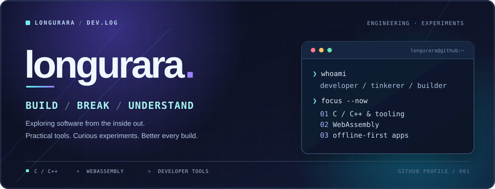
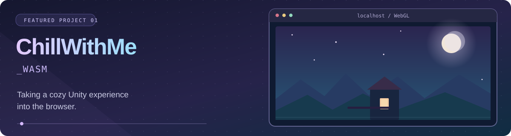
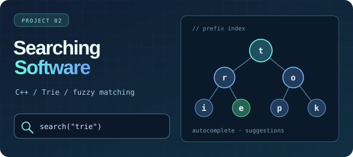
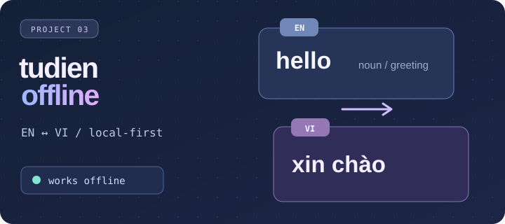
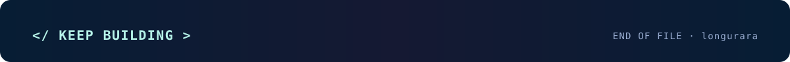

<!--
  GitHub profile README for github.com/longurara
  Theme: Midnight / Cyan / Iris
  Assets are maintained in ./assets — upload this folder together with README.md.
  Content is intentionally conservative about unverified awards, roles, and project maturity.
-->

<div align="center">
  <a href="https://github.com/longurara">
    
  </a>

  <p>
    <a href="#-about-me"><strong>About</strong></a>&nbsp; • &nbsp;
    <a href="#-selected-work"><strong>Projects</strong></a>&nbsp; • &nbsp;
    <a href="#-toolbox"><strong>Toolbox</strong></a>&nbsp; • &nbsp;
    <a href="#-github-activity"><strong>Activity</strong></a>
  </p>

  <a href="https://github.com/longurara?tab=followers"></a>
  <a href="https://github.com/longurara?tab=repositories"></a>
  
</div>

<br />

## ✦ About me

**Hey, I'm `@longurara`.** I like understanding the details behind how software works — then using what I learn to build something useful, interesting, or just a little unconventional.

My projects move between **C/C++ algorithms**, **developer utilities**, **offline-first web apps**, and **WebAssembly experiments**. I value clear code, practical problem-solving, and getting things working before polishing the edges.

```cpp
// What keeps me building:
constexpr auto approach = "explore → understand → build → improve";
```

<table>
<tr>
<td width="33%" valign="top"><strong>01 · LOW-LEVEL CURIOSITY</strong><br /><sub>Algorithms, C/C++, source code, and tools that help developers work faster.</sub></td>
<td width="33%" valign="top"><strong>02 · BEYOND THE DEFAULT</strong><br /><sub>Exploring what runs where — including Unity/WebGL and browser-side experiences.</sub></td>
<td width="33%" valign="top"><strong>03 · USEFUL BY DESIGN</strong><br /><sub>Fast, approachable, offline-friendly utilities made for everyday use.</sub></td>
</tr>
</table>

<br />

## ✦ Selected work

<sub>A few projects that reflect what I enjoy building. Click any cover to explore the repository.</sub>

<a href="https://github.com/longurara/ChillWithMe_Wasm"></a>

### [ChillWithMe_Wasm](https://github.com/longurara/ChillWithMe_Wasm) <sub>· Browser / WebGL exploration</sub>

Experimenting with bringing a Unity experience to the browser — exploring **WebGL builds**, asset handling, and browser-side integration. This is an **ongoing technical experiment**, not a finished production release.

`Unity` `WebGL` `WebAssembly` `Build tooling` &nbsp; [**View source ↗**](https://github.com/longurara/ChillWithMe_Wasm)

<br />

<table>
<tr>
<td width="50%" valign="top">
<a href="https://github.com/longurara/Searching-Software"></a>
<h3><a href="https://github.com/longurara/Searching-Software">Searching-Software ↗</a></h3>
<p>A C++ search utility exploring <strong>Trie-based indexing</strong>, autocomplete, and approximate matches for navigating source code.</p>
<p><code>C++</code> <code>Trie</code> <code>Search</code></p>
</td>
<td width="50%" valign="top">
<a href="https://github.com/longurara/tudienoffline"></a>
<h3><a href="https://github.com/longurara/tudienoffline">tudienoffline ↗</a></h3>
<p>A browser-based <strong>English ↔ Vietnamese dictionary</strong> designed to work locally without relying on a backend.</p>
<p><code>JavaScript</code> <code>HTML/CSS</code> <code>Offline-first</code></p>
</td>
</tr>
</table>

**Also exploring:** [WinUtilities-Pro](https://github.com/longurara/WinUtilities-Pro) · [FAP-GPA-Viewer](https://github.com/longurara/FAP-GPA-Viewer) · [All repositories ↗](https://github.com/longurara?tab=repositories)

<br />

## ✦ Toolbox

<div align="center">


<br /><br />

<code>Core: C / C++</code>&nbsp; <code>Web: JavaScript / HTML / CSS</code>&nbsp; <code>Exploring: Unity / WebAssembly</code>

</div>

<br />

## ✦ GitHub activity

<div align="center">
  <a href="https://github.com/longurara">
    
  </a>
  <a href="https://github.com/longurara?tab=repositories">
    
  </a>
</div>

<details>
  <summary><strong>▸ Expand contribution activity</strong></summary>
  <br />
  <div align="center">
    
  </div>
</details>

<br />

## ✦ What's next?

Right now, my curiosity keeps bringing me back to **C/C++**, **developer tooling**, and **making software run in places it wasn't originally designed for**.

> The best way to understand a system is to build with it, break assumptions, and improve the result.

For feedback, ideas, or collaboration, the best starting point is an issue or discussion in one of my [repositories](https://github.com/longurara?tab=repositories).

<div align="center">
  <a href="https://github.com/longurara?tab=repositories"></a>
  <a href="https://github.com/longurara"></a>
  <br /><br />
  
</div>
